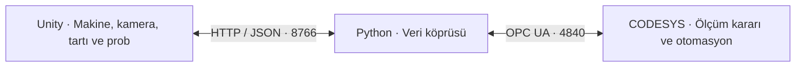

# RVM Dijital İkiz Model ve Otomasyon

PET, alüminyum ve cam ambalajları ölçerek ilgili toplama kutusuna yönlendiren bir **RVM (Reverse Vending Machine / geri dönüşüm otomatı)** simülasyonudur. Blender modeli Unity'de canlandırılır; işlem sırası ve nihai malzeme kararı CODESYS PLC programı tarafından yönetilir.

**v106**, kamera görüntüsü, temas tartısı ve sanal metal/manyetik probu aynı makine çevriminde birleştirir. Ambalajın seçilen etiketi PLC'ye tanıma sonucu olarak gönderilmez; PLC ham ölçümleri değerlendirir.

## Mimari ve veri akışı



| Bileşen | Görevi |
|---|---|
| **Blender** | Makine ve fiziksel test numunelerinin geometrisi, hareketli parçaları ve FBX modelleri. |
| **Unity / C#** | Sensörlerin simülasyonu, PLC komutlarına göre hareketler, kamera önizlemesi ve operatör tableti. |
| **Python / asyncua** | Veri tiplerini ve sınırlarını doğrulayan HTTP–OPC UA köprüsü. |
| **CODESYS / Structured Text** | Malzeme kararı, işlem sırası, komut onayları, hata denetimi ve sayaçlar. |

**Kontrolün sahibi PLC'dir.** Unity fiziksel dünyanın simülasyonunu ve geri bildirimleri üretir; Python köprüsü otomasyon sırası çalıştırmaz. CODESYS içindeki operatör paneli de paylaşılmıştır.

## Bir ambalajın çevrimi

1. Operatör nesne ekleme isteği gönderir. PLC'nin numune isteğini Unity karşılar ve oluşturduğu ürün kimliğini onaylar.
2. Konveyör ambalajı tanıma bölgesine getirir. Nesne, PLC tanıma onayı gelene kadar durdurucuda tutulur.
3. Aynı ambalaj temas tartısına oturur; kamera siyah/beyaz arka planla ölçüm alır ve sanal prob örneklenir.
4. Ham ölçümler ürün, istek ve oturum kimlikleriyle PLC'ye iletilir. `F_RVMMaterial106` bunlardan malzeme kodunu belirler.
5. Kabul edilen ambalaj kırma/ezme bölümüne taşınır. Hazne hedef kutuya gider, kapaklar açılır, boşaltma doğrulanır ve sayaç artırılır.
6. Hazne başlangıca döner. Tanınmayan veya kabul edilmeyen nesne ters bantla iade edilir.

Kodlar: **0 bilinmeyen/iade · 1 PET · 2 alüminyum · 3 cam**. Sıralamayı `FB_RVMControl106`, 20 ms çevrimli ana görevi `PRG_UnityRVM` yürütür.

## Ölçümler nasıl üretiliyor?

- **Kamera:** Sahnedeki gerçek render piksellerinden boy, en, doluluk, geçirgenlik ve yansıma göstergeleri çıkarılır. Başlangıçta boş istasyon kalibrasyonu yapılır. Desteklenen donanımda `AsyncGPUReadback`, diğerlerinde eşzamanlı okuma kullanılır.
- **Temas tartısı:** Çarpışma impulsu zaman adımına bölünerek kuvvet, kuvvet de yerçekimine bölünerek gram tahmini üretilir. Tek nesne teması, hareket ve ölçüm kararlılığı kontrol edilir.
- **Metal/manyetik prob:** Numuneye tanımlanan fiziksel tepki özelliklerinden mesafeye bağlı sanal sinyaller hesaplanır. Bilinmeyen özellikler geçerli ölçüm sayılmaz.

Sınıflandırma kuralları kontrollü numuneler için deneysel eşiklerdir. Bu sürüm fiziksel sensör bağlantısı, kimyasal malzeme analizi veya kırıcı için mekanik dayanım hesabı içermez. Laboratuvardaki Unity sınıflandırıcısı inceleme içindir; makinenin kabul kararını PLC verir.

## Haberleşme ayrıntıları

`RvmDigitalTwin.cs`, sensör paketini **`POST http://127.0.0.1:8766/exchange`** adresine JSON olarak yollar. `bridge.py`, `contract.json` alanlarını ve sınırlarını doğrular; OPC UA üzerinden **`GVL_RVMUnity`** değişkenlerine yazar. Varsayılan PLC adresi **`opc.tcp://localhost:4840`** şeklindedir. Bu adresler yerel bilgisayarı gösterir; geliştiriciye ait ağ adresleri değildir.

Köprü PLC çıkışlarını ayrı çevrimde okuyup önbelleğe alır. HTTP yanıtındaki `plc`, `connected` ve `error` alanları Unity'ye son durumu taşır. Yanıtın gelmesi, aynı isteğin PLC'de tamamlandığı anlamına gelmez; ilgili onay kimlikleri kontrol edilir.

| Yön | Başlıca veriler |
|---|---|
| **Unity → PLC** | Giriş/kapak/hazne sensörleri, hareket geri bildirimleri, operatör komutu ve ürün kimliği. |
| **Unity → PLC** | `rKutleGram`, `rGoruntuBoy`, `rGoruntuEn`, `rOptikGecirgenlik`, `rOlcumYansima`, `rOlcumMetal`, `rOlcumManyetik`; ölçüm geçerliliği ve yaşı. |
| **PLC → Unity** | Konveyör, kırıcı, hazne ve kapak komutları; hızlar, hedef konum, tanınan malzeme ve hedef kutu. |
| **PLC → Unity** | Nesne/görüntü istekleri, komut sonuçları, oturum onayları, durum/hata kodları ve sayaçlar. |

Alanların tam listesi [SINYALLER.md](simulasyon_unity/SINYALLER.md), tipler ve fiziksel sınırlar [contract.json](simulasyon_unity/contract.json) dosyasındadır. `BOOL`, `UINT`, `UDINT`, `REAL` tipleri sırasıyla OPC UA `Boolean`, `UInt16`, `UInt32`, `Float` olarak taşınır.

- **Sürüm ve oturum:** Üç katman da uygulama protokolü **106** kullanır. Unity önce `udiGorulenPlcOturumu=0` içeren HELLO paketi gönderir; PLC oturumu onaylandıktan sonra komut alışverişi devam eder. PLC yeniden başlarsa yeni eşleşme gerekir.
- **Paket bütünlüğü:** Giriş alanları başlangıç/bitiş işaretleri arasında yazılır. PLC işaretleri kopyalama öncesi ve sonrası denetler. Çıkışlar da `udiCikisBaslangic` / `udiCikisBitis` ile çevrelenir; köprü tutarsız okumayı tekrarlar.
- **Tekrar denetimi:** Geriye giden paket sayacı, kapatılmış oturum ve aynı paket kimliğiyle değiştirilmiş veri reddedilir. Aynı paketin tekrarı bağlantı zaman aşımını tazelemez.
- **Ölçüm eşleştirmesi:** Kamera isteği/cevabı; ürün, Unity oturumu ve PLC oturumuyla eşleşmelidir. PLC geçersiz veya eski ölçümü kabul etmez; geçerli ölçüm yaşı en çok 2 saniyedir.
- **Kesinti davranışı:** Unity 600 ms güncel PLC verisi alamazsa hareketi durdurur; PLC 750 ms iletişim denetimi uygular. Yeniden bağlantı üretimi kendiliğinden başlatmaz.

Unity her HTTP isteğinden sonra 40 ms, köprü OPC UA çevriminden sonra 35 ms bekler. İletişim, render ve işlem gecikmeleri bu sürelere eklenir.

## Kurulum ve kullanım

Windows, **Unity 6000.6.4f1**, **CODESYS V3.5 SP22 Patch 3 / Control Win V3 x64 3.5.22.30** ve **Python 3.12** kullanılır. Runtime ve OPC UA gereksinimleri kullanıcı bilgisayarında sağlanmalıdır.

1. `Codesys_Dosyalari/Paylasim/RVM_Unity_Dijital_Ikiz_v106.project` dosyasını açın; kendi PLC bağlantınızı seçip yükleyin ve çalıştırın.
2. Depo kökünde PowerShell ile Python ortamını kurup köprüyü açın:

   ```powershell
   .\simulasyon_unity\Kurulum.ps1
   .\simulasyon_unity\Baslat.ps1
   ```

3. Unity Hub'a `Unity/RVM` klasörünü ekleyin. **`Assets/RVM/Scenes/RVM_InlineMeasurement_v106.unity`** sahnesini açıp Play seçin.
4. Kalibrasyon tamamlanıp bağlantı yeşile döndüğünde **BAŞLAT** ve **NESNEYİ GİRİŞE KOY** ile çevrimi deneyin. Sonraki açılışlarda `Baslat_v106.cmd` köprüyü başlatabilir.

[KURULUM.md](KURULUM.md) kendi Python yolu, OPC UA hesabı/sertifikaları, hata giderme ve CODESYS projesini yeniden üretme adımlarını açıklar. Parolalar ve yerel ayarlar Git'e dahil edilmez.

## Dosyalar ve doğrulama

| Klasör | İçerik |
|---|---|
| `Unity/RVM/` | Ana v106 sahnesi, bağımsız ölçüm laboratuvarı, numuneler ve C# kaynakları. |
| `simulasyon_unity/` | Köprü, sözleşme, testler ve güncel PLC ST kaynakları. |
| `Codesys_Dosyalari/Paylasim/` | Temiz PLC projesi, paneli koruyan native uygulama aktarımı ve üretim betiği. |
| `ModelKaynaklari/` | Ölçüm numunelerinin Blender kaynakları ve fiziksel referans değerleri. |
| `24_farkli_test_objesi/` | 24 üründen oluşan test nesneleri: toplu Blender kataloğu, tekil modeller ve ölçü/kütle tablosu. |
| `unity_icin_RVM_blender_denemesi/` | Makinenin Blender/FBX kaynakları. |

Unity'de **RVM → Paylaşım projesini doğrula** menüsü sahne, kamera, tartı, prob ve numune referanslarını denetler. Python testleri paket kurallarını, yeniden bağlantı davranışını ve derlenmiş PLC sembollerini kontrol eder. Bu kontroller canlı PLC ile uçtan uca kabul testinin yerine geçmez.

[24 test nesnesinin kullanımı](24_farkli_test_objesi/README.md): Blender dosyalarının dokuları gömülüdür. Bu ek model seti mevcut Unity/CODESYS sahnesine otomatik bağlanmaz; aktarım ve fizik/sensör ayarları hedef sahnede yapılır.
